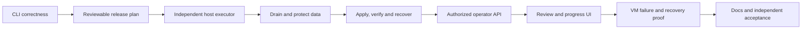

# Managed in-place updates: feature map

Status: U1–U7 ([#1108](https://github.com/adamgreenwell/wayfindr/issues/1108)–[#1114](https://github.com/adamgreenwell/wayfindr/issues/1114))
are complete; the opt-in host helper first shipped in 1.2.0. U8 qualification
([#1115](https://github.com/adamgreenwell/wayfindr/issues/1115)) and U9 operator
acceptance ([#1116](https://github.com/adamgreenwell/wayfindr/issues/1116)) remain
open, with helper follow-ups [#1131](https://github.com/adamgreenwell/wayfindr/issues/1131)
and [#1140](https://github.com/adamgreenwell/wayfindr/issues/1140). As of 1.6.0
(helper `0.11.0`), managed application upgrades and protective-archive recovery
remain unqualified, with 0/100 managed scenarios qualified.
Mapped: October 8, 2026. Status updated: November 13, 2026.

Epic: [#1107](https://github.com/adamgreenwell/wayfindr/issues/1107) — safe managed in-place updates for self-hosted Wayfindr.
Milestone: [Managed in-place updates](https://github.com/adamgreenwell/wayfindr/milestone/3).
Project: [Wayfindr Project](https://github.com/users/adamgreenwell/projects/14).
Design: [in-place updates plan](../architecture/in-place-updates-plan.md).

## First delivery

An operator running Wayfindr through the official one-line installer on a Linux
VM can review a stable release, run a protected update, follow the expected
restart, and inspect the verified result or recovery instructions. The app's
containers are replaced while installation identity, data, keys, configuration
and certificates stay in place.

The nine features below are native sub-issues of the epic. Each GitHub issue has
its outcome, scope, acceptance checklist, existing code/docs, and blocked-by
relationships. All begin in Todo. The milestone has no promised release number
or delivery date.

| Feature | Issue | Outcome | Phase | Priority | Depends on |
| --- | --- | --- | --- | --- | --- |
| U1: Harden the existing terminal upgrade path | [#1108](https://github.com/adamgreenwell/wayfindr/issues/1108) | A terminal upgrade changes the stack only after its target is validated and reports success only for the requested release. | Foundation | P1 | None |
| U2: Build a reusable update plan and installation capability contract | [#1109](https://github.com/adamgreenwell/wayfindr/issues/1109) | CLI and operator controls can review one exact update plan and accurately identify supported ownership and required actions. | Foundation | P1 | [#1108](https://github.com/adamgreenwell/wayfindr/issues/1108) |
| U3: Add the independent host updater and durable operation journal | [#1110](https://github.com/adamgreenwell/wayfindr/issues/1110) | An enrolled Linux VM has an independent, restricted executor with recoverable status throughout application replacement. | Execution | P1 | [#1109](https://github.com/adamgreenwell/wayfindr/issues/1109) |
| U4: Coordinate write draining and protective upgrade backups | [#1111](https://github.com/adamgreenwell/wayfindr/issues/1111) | The managed update has a verified protective backup after bounded draining and before schema mutation. | Execution | P1 | [#1109](https://github.com/adamgreenwell/wayfindr/issues/1109), [#1110](https://github.com/adamgreenwell/wayfindr/issues/1110) |
| U5: Implement managed apply, service verification, and interruption recovery | [#1112](https://github.com/adamgreenwell/wayfindr/issues/1112) | The host executor applies a protected update, verifies the requested stack, and distinguishes success, safe fallback, and recovery-required outcomes. | Execution | P1 | [#1108](https://github.com/adamgreenwell/wayfindr/issues/1108), [#1109](https://github.com/adamgreenwell/wayfindr/issues/1109), [#1110](https://github.com/adamgreenwell/wayfindr/issues/1110), [#1111](https://github.com/adamgreenwell/wayfindr/issues/1111) |
| U6: Expose authorized operator update actions and durable history | [#1113](https://github.com/adamgreenwell/wayfindr/issues/1113) | Platform operators can review, recheck, start, inspect, and safely cancel an update through bounded application endpoints. | Operator experience | P1 | [#1109](https://github.com/adamgreenwell/wayfindr/issues/1109), [#1110](https://github.com/adamgreenwell/wayfindr/issues/1110), [#1112](https://github.com/adamgreenwell/wayfindr/issues/1112) |
| U7: Build the update review and reconnecting progress experience | [#1114](https://github.com/adamgreenwell/wayfindr/issues/1114) | The operator console offers a reviewable update and a calm progress dialog that resumes the same run after reconnecting. | Operator experience | P2 | [#1109](https://github.com/adamgreenwell/wayfindr/issues/1109), [#1113](https://github.com/adamgreenwell/wayfindr/issues/1113) |
| U8: Qualify managed update failures and recovery on disposable VMs | [#1115](https://github.com/adamgreenwell/wayfindr/issues/1115) | Repeatable disposable-VM evidence proves the supported update/failure matrix and data survival using published artifacts. | Qualification | P1 | [#1111](https://github.com/adamgreenwell/wayfindr/issues/1111), [#1112](https://github.com/adamgreenwell/wayfindr/issues/1112), [#1113](https://github.com/adamgreenwell/wayfindr/issues/1113), [#1114](https://github.com/adamgreenwell/wayfindr/issues/1114) |
| U9: Publish update and recovery guidance and complete independent operator acceptance | [#1116](https://github.com/adamgreenwell/wayfindr/issues/1116) | A person who did not author the updater can enroll, update, reconnect, and recover using the published instructions. | Qualification | P2 | [#1114](https://github.com/adamgreenwell/wayfindr/issues/1114), [#1115](https://github.com/adamgreenwell/wayfindr/issues/1115) |

## Delivery order

This shows the main sequence; the table and GitHub dependency relationships
include all direct prerequisites. The first slice is [#1108](https://github.com/adamgreenwell/wayfindr/issues/1108): stage
configuration before activation, abort failed official-image pulls, preserve
the old stack, and verify the requested release instead of HTTP availability
alone. The `next-slice` label identifies that recommendation.

## Later features

These are separate backlog issues related to the epic, with P3 priority and the
Follow-on phase. They are blocked by completion of the first epic and are not
its sub-issues or completion gates.

| Feature | Issue | Outcome |
| --- | --- | --- |
| Explore managed host-PHP/Git adapters and deployment-platform hooks | [#1117](https://github.com/adamgreenwell/wayfindr/issues/1117) | A later scoped proposal establishes safe host-PHP and platform-specific update integration after the managed VM path is qualified. |
| Design optional scheduled or unattended managed updates | [#1118](https://github.com/adamgreenwell/wayfindr/issues/1118) | A later design specifies opt-in scheduling on top of the proven managed update engine. |
| Define and prove compatibility-based post-migration application rollback | [#1119](https://github.com/adamgreenwell/wayfindr/issues/1119) | A later manifest/qualification extension can permit bounded application rollback only for a proven compatible release span. |

## Completion and operating boundaries

- Required work is delivered to `main` with scoped evidence before moving it to
  Done. Board cards and local tests alone do not establish a working updater.
- Qualification uses published artifacts on disposable VMs, including supported
  release spans, failed pulls/backups, concurrent operations, lost connections,
  helper/VM restart, migration interruptions, and broken/stale runtime services.
- Success proves target version/commit, published image-index to platform-image
  linkage, guards/migrations, fresh workers/scheduler, database/Redis, Reverb,
  and the configured HTTP origin.
- Synthetic support data, local/remote attachments, encrypted settings and keys,
  erasure ledger, installation identity, proxy configuration and certificates
  survive the qualified scenarios. Backup creation and restore proof are
  recorded separately.
- A non-author follows the published enrollment/update/recovery instructions,
  completes an update and reconnection, and observes a bounded recovery case.
  Existing independent installation acceptance in
  [#797](https://github.com/adamgreenwell/wayfindr/issues/797) is a foundation,
  not acceptance of this new flow.
- The host helper owns execution and Docker access. Operator requests use a
  restricted authenticated interface; tenant roles do not control deployments.
- Existing terminal and externally managed updates stay valid without helper
  enrollment, a new systemd dependency, or manual offsite-backup prerequisites.
  Optional managed policy is separate from release-required operator work.
- Cancellation is limited to before Apply/schema mutation. Only the operation's
  own maintenance hold may be lifted. Changed or uncertain schema state needs
  explicit recovery; the MVP performs no automatic post-migration downgrade or
  database restore.
- Infrastructure major upgrades, uninterrupted-chat guarantees, source/platform
  automation and scheduling remain outside the first delivery.

The [epic](https://github.com/adamgreenwell/wayfindr/issues/1107) is the live delivery index. The
[design plan](../architecture/in-place-updates-plan.md) records the architectural
reasoning; the [roadmap](roadmap.md) records where the work stands.
